import os, textwrap, zipfile

base = "/mnt/data/arjun-github-profile"
os.makedirs(base + "/assets", exist_ok=True)
os.makedirs(base + "/.github/workflows", exist_ok=True)
os.makedirs(base + "/scripts", exist_ok=True)

files = {}

files["README.md"] = r'''

  

  <a href="https://github.com/arjunrajbhar1116-collab">PROFILE</a> ·
  <a href="https://github.com/arjunrajbhar1116-collab?tab=repositories">REPOSITORIES</a> ·
  <a href="https://github.com/arjunrajbhar1116-collab?tab=stars">STARS</a>

  
  
  

---

01 — INTRODUCTION

# Hello, I'm Arjun.

I'm a **Shopify Developer and Web Developer** interested in building polished e-commerce storefronts, useful theme components, and responsive web experiences.

- **Shopify:** theme customization, Liquid, sections, templates, and storefront UI
- **Frontend:** HTML, CSS, JavaScript, responsive layouts, and interaction design
- **Approach:** practical features, maintainable code, and thoughtful customer experiences

  

02 — SELECTED WORK

# Products, not just pages.

<table>
  <tr>
    <td width="50%" valign="top">
      <h3>01 / Shopify storefronts</h3>
      Responsive shopping experiences, product pages, collection layouts, and navigation.
        
      <a href="https://github.com/arjunrajbhar1116-collab?tab=repositories">EXPLORE REPOSITORIES ↗</a>
    </td>
    <td width="50%" valign="top">
      <h3>02 / Theme engineering</h3>
      Custom Liquid sections, reusable components, theme settings, and product interfaces.
        
      <a href="https://github.com/arjunrajbhar1116-collab?tab=repositories">EXPLORE REPOSITORIES ↗</a>
    </td>
  </tr>
  <tr>
    <td width="50%" valign="top">
      <h3>03 / Store interactions</h3>
      Product variants, cart interactions, mobile navigation, and user-focused UI improvements.
        
      <a href="https://github.com/arjunrajbhar1116-collab?tab=repositories">EXPLORE REPOSITORIES ↗</a>
    </td>
    <td width="50%" valign="top">
      <h3>04 / Frontend experiments</h3>
      Reusable interface patterns and practical web development experiments.
        
      <a href="https://github.com/arjunrajbhar1116-collab?tab=repositories">EXPLORE REPOSITORIES ↗</a>
    </td>
  </tr>
</table>

> These are project categories, not verified repository claims. Replace them with individual projects and demos as you add them to GitHub.

  

03 — TECHNICAL TOOLKIT

# The tools I build with.

  
  
  
  
  
  
  

  

04 — BUILDING ACTIVITY

# A record of building.

  

  
  

  

  

05 — PRINCIPLES

# Details make the difference.

<table>
  <tr>
    <td width="50%" valign="top"><b>01 / Thoughtful interfaces</b>  Clear, responsive layouts that feel intuitive across devices.</td>
    <td width="50%" valign="top"><b>02 / Maintainable code</b>  Reusable components and sensible implementation.</td>
  </tr>
  <tr>
    <td width="50%" valign="top"><b>03 / Practical improvements</b>  Features that help make storefronts easier to use.</td>
    <td width="50%" valign="top"><b>04 / Continuous learning</b>  Learning, testing, and refining through real projects.</td>
  </tr>
</table>

---

06 — CONNECT

<h2 align="center">Let's build something worth shipping.</h2>

Shopify development · E-commerce · Frontend engineering

  

  

'''

files["assets/hero.svg"] = r'''<svg xmlns="http://www.w3.org/2000/svg" width="1200" height="330" viewBox="0 0 1200 330" role="img" aria-labelledby="title desc">
<title id="title">Arjun Rajbhar — Shopify Developer</title><desc id="desc">Dark purple abstract portfolio header.</desc>
<defs>
  <linearGradient id="bg" x1="0" y1="0" x2="1" y2="1"><stop stop-color="#10002b"/><stop offset=".52" stop-color="#3c096c"/><stop offset="1" stop-color="#7b2ff7"/></linearGradient>
  <radialGradient id="glow"><stop stop-color="#c77dff" stop-opacity=".35"/><stop offset="1" stop-color="#c77dff" stop-opacity="0"/></radialGradient>
  <pattern id="grid" width="28" height="28" patternUnits="userSpaceOnUse"><path d="M28 0H0V28" fill="none" stroke="#e0aaff" stroke-opacity=".08"/></pattern>
</defs>
<rect width="1200" height="330" rx="22" fill="url(#bg)"/><rect width="1200" height="330" rx="22" fill="url(#grid)"/>
<circle cx="1000" cy="125" r="250" fill="url(#glow)"/>
<circle cx="1000" cy="125" r="118" fill="none" stroke="#e0aaff" stroke-opacity=".25"/>
<circle cx="1000" cy="125" r="88" fill="none" stroke="#e0aaff" stroke-opacity=".2" stroke-dasharray="4 9"/>
<path d="M800 250L1160 35M850 290L1190 85" stroke="#e0aaff" stroke-opacity=".12"/>
<text x="74" y="72" font-family="monospace" font-size="15" letter-spacing="5" fill="#e0aaff">SHOPIFY / WEB DEVELOPMENT</text>
<text x="70" y="155" font-family="Georgia,serif" font-size="58" fill="#fff">Arjun Rajbhar</text>
<text x="74" y="202" font-family="Arial,sans-serif" font-size="23" fill="#eadcff">Shopify Developer</text>
<text x="74" y="244" font-family="Arial,sans-serif" font-size="16" fill="#d8b4fe">Building thoughtful storefronts and responsive experiences.</text>
<path d="M75 277H365" stroke="#e0aaff" stroke-width="2"/><circle cx="377" cy="277" r="4" fill="#fff"/>
<text x="1110" y="300" text-anchor="end" font-family="monospace" font-size="12" letter-spacing="3" fill="#e0aaff">PORTFOLIO / 001</text>
</svg>'''

files["assets/divider.svg"] = r'''<svg xmlns="http://www.w3.org/2000/svg" width="1200" height="32" viewBox="0 0 1200 32">
<defs><linearGradient id="line"><stop stop-color="#3c096c" stop-opacity="0"/><stop offset=".5" stop-color="#9d4edd"/><stop offset="1" stop-color="#3c096c" stop-opacity="0"/></linearGradient></defs>
<path d="M0 16H1200" stroke="url(#line)" stroke-width="1.5"/><circle cx="600" cy="16" r="3" fill="#c77dff"/><circle cx="588" cy="16" r="1.5" fill="#7b2ff7"/><circle cx="612" cy="16" r="1.5" fill="#7b2ff7"/>
</svg>'''

files["assets/footer.svg"] = r'''<svg xmlns="http://www.w3.org/2000/svg" width="1200" height="150" viewBox="0 0 1200 150" role="img" aria-labelledby="t">
<title id="t">Arjun Rajbhar — Shopify Developer</title>
<defs><linearGradient id="g"><stop stop-color="#10002b"/><stop offset=".55" stop-color="#3c096c"/><stop offset="1" stop-color="#7b2ff7"/></linearGradient></defs>
<rect width="1200" height="150" rx="18" fill="url(#g)"/>
<path d="M0 28Q300 90 600 35T1200 25" fill="none" stroke="#e0aaff" stroke-opacity=".25"/>
<text x="600" y="77" text-anchor="middle" font-family="Georgia,serif" font-size="34" fill="#fff">Arjun Rajbhar</text>
<text x="600" y="108" text-anchor="middle" font-family="monospace" font-size="13" letter-spacing="3" fill="#e0aaff">SHOPIFY DEVELOPER · BUILT WITH CURIOSITY</text>
</svg>'''

files["assets/contribution-heatmap.svg"] = r'''<svg xmlns="http://www.w3.org/2000/svg" width="1200" height="170" viewBox="0 0 1200 170">
<rect width="1200" height="170" rx="14" fill="#10002b" stroke="#5a189a"/>
<text x="28" y="35" font-family="monospace" font-size="16" fill="#e0aaff">CONTRIBUTION HEATMAP</text>
<text x="28" y="58" font-family="Arial,sans-serif" font-size="12" fill="#cdb4db">This placeholder will be refreshed by GitHub Actions after setup.</text>
''' + ''.join(f'<rect x="{28+col*16}" y="{78+row*15}" width="10" height="10" rx="2" fill="{["#240046","#3c096c","#5a189a","#7b2ff7","#c77dff"][(col*7+row*3)%5]}" opacity=".45"/>' for col in range(70) for row in range(5)) + r'''
<text x="28" y="160" font-family="monospace" font-size="10" fill="#cdb4db">UPDATE WORKFLOW TO DISPLAY LIVE CONTRIBUTION DATA</text></svg>'''

files["scripts/update_heatmap.py"] = r'''import json
import os
import urllib.request
from datetime import date, datetime, timedelta, timezone
from pathlib import Path
from xml.sax.saxutils import escape

USERNAME = os.environ.get("GITHUB_USERNAME", "arjunrajbhar1116-collab")
TOKEN = os.environ["GH_TOKEN"]
OUT = Path("assets/contribution-heatmap.svg")

query = """
query($login: String!) {
  user(login: $login) {
    contributionsCollection {
      contributionCalendar {
        totalContributions
        weeks {
          contributionDays { date contributionCount }
        }
      }
    }
  }
}
"""
payload = json.dumps({"query": query, "variables": {"login": USERNAME}}).encode()
request = urllib.request.Request(
    "https://api.github.com/graphql",
    data=payload,
    headers={
        "Authorization": f"Bearer {TOKEN}",
        "Content-Type": "application/json",
        "User-Agent": "profile-readme-heatmap",
    },
)
with urllib.request.urlopen(request, timeout=30) as response:
    data = json.load(response)

if data.get("errors") or not data.get("data", {}).get("user"):
    raise SystemExit(f"GitHub GraphQL query failed: {data.get('errors', 'user not found')}")

calendar = data["data"]["user"]["contributionsCollection"]["contributionCalendar"]
weeks = calendar["weeks"]
days = [day for week in weeks for day in week["contributionDays"]]
max_count = max((d["contributionCount"] for d in days), default=0)
palette = ["#240046", "#3c096c", "#5a189a", "#7b2ff7", "#c77dff"]

def shade(count):
    if count == 0 or max_count == 0:
        return "#21142f"
    ratio = count / max_count
    return palette[min(4, max(1, int(ratio * 4) + 1))]

width, height = 1200, 188
left, top, cell, gap = 30, 66, 11, 5
svg = [
    f'<svg xmlns="http://www.w3.org/2000/svg" width="{width}" height="{height}" viewBox="0 0 {width} {height}">',
    '<rect width="100%" height="100%" rx="14" fill="#10002b" stroke="#5a189a"/>',
    '<text x="30" y="30" font-family="monospace" font-size="16" fill="#e0aaff">CONTRIBUTION HEATMAP</text>',
    f'<text x="30" y="49" font-family="Arial,sans-serif" font-size="12" fill="#cdb4db">{calendar["totalContributions"]:,} contributions in the last year</text>',
]
for i, week in enumerate(weeks):
    for day in week["contributionDays"]:
        dt = date.fromisoformat(day["date"])
        x = left + i * (cell + gap)
        y = top + dt.weekday() * (cell + gap)
        if x + cell < width - 20:
            title = escape(f'{day["date"]}: {day["contributionCount"]} contributions')
            svg.append(
                f'<rect x="{x}" y="{y}" width="{cell}" height="{cell}" rx="2" '
                f'fill="{shade(day["contributionCount"])}"><title>{title}</title></rect>'
            )
svg += [
    '<text x="30" y="178" font-family="Arial,sans-serif" font-size="11" fill="#cdb4db">Less</text>'
]
for i, color in enumerate(palette):
    svg.append(f'<rect x="{70+i*18}" y="166" width="12" height="10" rx="2" fill="{color}"/>')
svg += [
    '<text x="170" y="178" font-family="Arial,sans-serif" font-size="11" fill="#cdb4db">More</text>',
    '</svg>'
]
OUT.write_text("\n".join(svg), encoding="utf-8")
print(f"Updated {OUT} for {USERNAME}")
'''

files[".github/workflows/update-heatmap.yml"] = r'''name: Update contribution heatmap

on:
  workflow_dispatch:
  schedule:
    - cron: "23 5 * * *"

permissions:
  contents: write

jobs:
  update:
    runs-on: ubuntu-latest
    steps:
      - name: Check out profile repository
        uses: actions/checkout@v4

      - name: Set up Python
        uses: actions/setup-python@v5
        with:
          python-version: "3.x"

      - name: Generate contribution heatmap
        env:
          GH_TOKEN: ${{ secrets.GITHUB_TOKEN }}
          GITHUB_USERNAME: arjunrajbhar1116-collab
        run: python scripts/update_heatmap.py

      - name: Commit updated heatmap
        run: |
          if git diff --quiet -- assets/contribution-heatmap.svg; then
            echo "Heatmap unchanged."
            exit 0
          fi
          git config user.name "github-actions[bot]"
          git config user.email "41898282+github-actions[bot]@users.noreply.github.com"
          git add assets/contribution-heatmap.svg
          git commit -m "chore: update contribution heatmap"
          git push
'''

files["SETUP.md"] = r'''# Setup — Arjun Rajbhar GitHub profile

## Upload the files

1. Open the profile repository: https://github.com/arjunrajbhar1116-collab/arjunrajbhar1116-collab
2. Extract this ZIP on your computer.
3. Upload the contents into the **root** of that repository. Keep the `.github/workflows`, `assets`, and `scripts` folder structure.
4. Commit the changes to the `main` branch.
5. Open the repository's **Actions** tab and enable Actions if GitHub prompts you.
6. Run **Update contribution heatmap** using **Run workflow** once, or wait for the scheduled run.

## If the workflow cannot push

In the repository, go to **Settings → Actions → General → Workflow permissions** and enable **Read and write permissions**. Save, then rerun the workflow. The workflow uses the built-in `GITHUB_TOKEN`; do not paste personal access tokens into the README or source files.

## Customize before publishing

- Update project categories in `README.md` with real repository links.
- Remove any skill badge you don't actually use.
- Add portfolio, LinkedIn, or contact links only if you want them public.
- Statistics cards and activity graph use third-party services and may occasionally be unavailable.

The contribution heatmap is generated from GitHub's contribution calendar. It is a static SVG updated by the workflow, not a live animation.
'''

for rel, content in files.items():
    path = os.path.join(base, rel)
    os.makedirs(os.path.dirname(path), exist_ok=True)
    with open(path, "w", encoding="utf-8") as f:
        f.write(content)

zip_path = "/mnt/data/arjunrajbhar1116-collab-profile-package.zip"
with zipfile.ZipFile(zip_path, "w", zipfile.ZIP_DEFLATED) as z:
    for rel in files:
        z.write(os.path.join(base, rel), arcname=rel)

print(f"Created profile package: {zip_path}")
print(f"Files included: {len(files)}")
